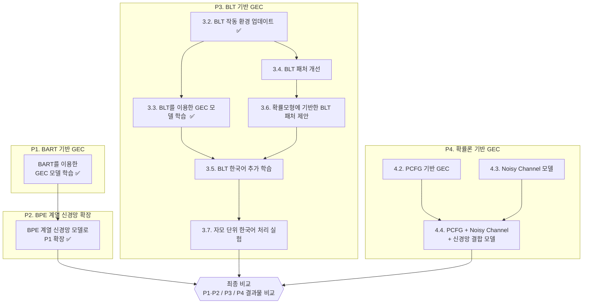

# 한국어 GEC 프로젝트

## 개요

이 레포는 한국어 문법 오류 교정(GEC, Grammatical Error Correction) 프로젝트의 전체 아이디어를 설명하고, 각 단계의 세부 구현 방법 및 결과를 정리하며, 각 단계별 관련된 레포로 연결하기 위한 상위 레포입니다.

---

## 착안점

한국어 GEC 프로젝트의 출발점은 정제되지 않은 한국어 텍스트는 분석이나 처리에 적합하지 않다는 점입니다. 머신러닝이 출현하기 전 단계부터 쌓여온 수많은 데이터는 정제되지 않았고, 지금도 이런 상태로 쌓이고 있는 텍스트 데이터는 무수히 많습니다. 

이러한 데이터를 쉽고 경제적으로 전처리할 수 있는 방법을 찾고자 하는 것이 이 프로젝트의 출발점입니다. 

이를 위해 언어모델 중 주류를 차지하고 있는 트랜스포머 기반 모델을 활용한 한국어 GEC 모델을 구현할 수 있는 방법을 탐색하고, 사람이 오류문을 보고 교정하는 과정을 확률론적으로 모델링하여 트랜스포머 기반 모델보다 빠르고 효율적인 한국어 GEC 모델을 구현할 수 있는 방법을 제안하는 것을 목표로 합니다. 

---

## 전체 프로젝트 구성

전체 프로젝트의 구성과 흐름은 다음과 같습니다.




- (P1, P2) 트랜스포머 기반의 기존 생성모델을 추가 학습하는 방식으로 한국어 GEC 모델을 구현합니다.

- (P3) BLT 모델을 활용하여 한국어 GEC 모델을 구현합니다. 이 과정에서 실험실 단계에서 공개한 BLT 모델의 작동 효율성을 개선하는 서브 프로젝트를 수행합니다.

- (P4) 확률이론을 이용하여 한국어 GEC 모델을 구현합니다. PCFG와 잡음-채널 모델(Noisy Channel Model, NCM)을 이용하여 문법 오류와 철자 오류를 탐색하는 모델로 텍스트를 처리한 후 신경망 모델을 결합하여 교정하는 방식의 GEC 구상을 구현합니다.

---

## P1. BART를 이용한 GEC 모델 학습(완료)

이 프로젝트는 [Yoon et al.(2023)](https://arxiv.org/abs/2210.14389)에서 제안한 KoBART 기반의 한국어 GEC 모델을 기반으로 데이터 추가학습을 통해 한국어 GEC 모델을 개선하는 것을 목표로 합니다.

프로젝트의 세부 목표는 다음과 같습니다.

- Yoon(2023)의 실험 재현을 위한 코드 수정 [완료]

- Yoon(2023)의 실험 결과 재현 [완료]

[P1의 세부 내용은 다음 레포를 참조하기 바랍니다.](https://github.com/esoterikosQ/26-13_PHDQ_BART)

---

## P2. 다양한 언어 모델을 이용한 P1 확장(완료)

이 프로젝트는 Yoon(2023)의 연구 방법을 다양한 언어 모델에 적용하여 P1을 통해 구현한 한국어 GEC 모델을 확장하는 것을 목표로 합니다.

### 2.1. 언어 모델

이 프로젝트에서는 KoBART(파라미터 사이즈 : 124M) 외에도 한국어 사전학습이 완료된 다양한 종류의 언어 모델을 선정하여 Yoon(2023)의 데이터셋을 추가 학습했습니다.

- [mBART-50](https://huggingface.co/facebook/mbart-large-50) : 메타(페이스북)에서 개발한 seq2seq 기반의 다국어 모델. 한국어를 공식 지원하는 모델로, 별도의 사전학습 없이 한국어를 처리할 수 있으며, 다국어 모델의 GEC 성능이 얼마나 다른지를 확인하기 위해 선택했습니다.(파라미터 사이즈 : 611M)

- pko-t5 : 구글의 T5 모델을 기반으로 한국어 데이터를 이용하여 (주)파우스트가 한국어 데이터로 추가 학습한 모델. [base](https://huggingface.co/paust/pko-t5-base), [large](https://huggingface.co/paust/pko-t5-large) 두 종류의 모델을 제공하며, 모델의 크기와 GEC 성능의 관계를 확인하기 위해 선택했습니다.(파라미터 사이즈 : 276M, 821M)

- [kanana-1.5-2.1b-instruct-2505](https://huggingface.co/kanana-1.5-2.1b-instruct-2505) : 카카오에서 제공하는 모델로, 한국어를 기반으로 사전 학습한 모델입니다. LLM을 기반으로 GEC 모델을 생성했을 때의 성능 차이를 확인하기 위해 선택했습니다.(파라미터 사이즈 : 2.09B)

---

### 2.2. 비교 결과

Yoon(2023)의 연구 방법에 기반한 모델 간 비교 결과는 다음과 같습니다.

- 개별 데이터셋 추가 학습 & 평가 결과(GLEU 점수 기준)

| 모델 | korean_learner | native | lang8 | union |
| --- | --- | --- | --- | --- |
| 논문 방식 KoBART | 45.68 | 68.40 | 29.65 | 34.75 |
| 개선 KoBART | 52.46 ±0.33 | 78.69 ±0.09 | 35.65 ±0.13 | 44.40 ±0.14 |
| pko-t5-base | 57.45 ±0.25 | 82.36 ±0.19 | 37.95 ±0.11 | 47.17 ±0.05 |
| mBART-50 | 52.62 ±0.13 | 79.88 ±0.18 | 36.03 ±0.10 | 44.75 ±0.09 |
| **pko-t5-large** | **59.19** ±0.17 | 82.70 ±0.12 | **39.84** ±0.15 | **49.16** ±0.12 |
| kanana-1.5-2.1b | 58.52 ±0.15 | **82.96** ±0.04 | 39.11 ±0.32 | 48.66 ±0.23 |

[P2의 세부 내용은 다음 레포를 참조하기 바랍니다.](https://github.com/esoterikosQ/26-13_PHDQ_BART)

---

## P3. BLT 기반의 GEC 모델 학습

페이즈3에서는 BLT 모델을 활용하여 한국어 GEC 모델을 구현하는 것을 목표로 합니다. 

### 3.1. BLT 모델 개요

[BLT](https://huggingface.co/facebook/blt)는 메타(페이스북)에서 2024년 발표한 언어 모델로, 기존의 언어 모델이 토큰 기반으로 작동하는 것과 달리 바이트 단위로 데이터를 처리합니다. 바이트 단위로 들어오는 자연어 입력을 엔트로피 기반으로 패칭한 후, 패칭한 데이터를 트랜스포머에서 처리하여 다음 바이트를 예측하는 방식으로 작동합니다.

메타(페이스북)는 BLT 모델이 가지는 장점을 다음과 같이 제시합니다. (1) 입력을 바이트 단위로 처리하기 때문에 언어의 종류와 문자 체계에 따라 토크나이저를 별도로 설계할 필요가 없습니다. (2) 엔트로피를 기준으로 유사성이 낮은 구간에서 패칭을 수행하여 토크나이저에서 처리하기 때문에 데이터의 종류와 관계없이 기계적으로 토큰 단위로 분리하는 모델에 비해 트랜스포머 작동이 효율적입니다.

본 프로젝트에서는 위와 같은 BLT의 장점을 GEC에 다음과 같이 활용할 수 있다는 가설을 가지고 BLT 모델에 주목했습니다. 텍스트의 오류 부분은 기존의 텍스트에서 출현 빈도가 낮기 때문에 패칭이 발생하기가 쉽고, 따라서, 정문과 비문의 처리가 명확하게 구분될 수 있습니다. 또한, 바이트 단위로 데이터를 처리하기 때문에 입력문을 완성형 글자 단위의 바이트로 처리하는 경우와 자모 단위로 분해해서 처리하는 경우 모두에 유연하게 대응할 수 있습니다. 

BLT 모델의 구성 및 작동 과정은 아래와 같습니다.

```mermaid
flowchart TD
   A["문자열과 생성 접두부"] --> BLT 모델의 바이트 생성 속도가 매우 느려집니다집니다. 

   한국어 GEC 프로젝트와 관련하여 이 부분이 크게 문제가 되는 이유는, 추가 학습을 통해 웨이트를 업데이트할 때에 최고 점수 모델을 선택하기 위해서는 반드시 업데이트한 웨이트로 텍스트를 생성한 결과를 바탕으로 성능을 평가해야 하는데, 엔트로피 패처의 캐시 기능이 없기 때문에 생성에 지나치게 많은 시간이 들고, 실질적인 학습 효율이 매우 떨어지기 때문입니다. 
   ["바이트 ID 결정: UTF-8 바이트 → byte + 4 ID<br/>BOS 및 구분자 
   이 프로젝트에서는 엔트로피 패처의 캐시를 구현하기 위해서 다음 작업을 수행했습니다.
   
   - 엔트로피 패처의 계산 결과를 저장하는 별도의 캐시 구조 구현
   
   - 텍스트 입력을 처리하는 과정에서 캐시가 있는 상태와 없는 상태에서 트랜스포머 각 층의 계산값 일치 여부 및 패치 경계 계산 결과 동일성 검증포함"]


   [ 이 프로젝트의 세부 내용은 다음 레포를 참조하기 바랍니다.](https://github.com/esoterikosQ/26_14_CACHE)
   BLT 모델의 바이트 생성 속도가 매우 느려집니다집니다. 
   한국어 GEC 프로젝트와 관련하여 이 부분이 크게 문제가 되는 이유는, 추가 학습을 통해 웨이트를 업데이트할 때에 최고 점수 모델을 선택하기 위해서는 반드시 업데이트한 웨이트로 텍스트를 생성한 결과를 바탕으로 성능을 평가해야 하는데, 엔트로피 패처의 캐시 기능이 없기 때문에 생성에 지나치게 많은 시간이 들고, 실질적인 학습 효율이 매우 떨어지기 때문입니다. 
    --> C["패딩 없는 입력 ID"]

이 프로젝트는 `facebook/blt-1b` 모델의 모든 구성요소에 한국어 데이터로 추가 학습을 하는 것을 목표로 합니다.


	이 프로젝트에서는 엔트로피 패처의 캐시를 구현하기 위해서 다음 작업을 수행했습니다.

	- 엔트로피 패처의 계산 결과를 저장하는 별도의 캐시 구조 구현

	- 텍스트 입력을 처리하는 과정에서 캐시가 있는 상태와 없는 상태에서 트랜스포머 각 층의 계산값 일치 여부 및 패치 경계 계산 결과 동일성 검증
`facebook/blt-1b`의 엔트로피 패처와 비견할만한 성능을 가진 확률모형 기반의 패처를 제안하는 것을 목표로 합니다.

BLT의 엔트로피 패처는 

	[ 이 프로젝트의 세부 내용은 다음 레포를 참조하기 바랍니다.](https://github.com/esoterikosQ/26_14_CACHE)
   C -->|"경계 결정용 ID"| P["별도 학습된 엔트로피 언어모델<br/>자체 임베딩 → 국소 인과적 어텐션/FFN → 다음 바이트 로짓"]
   P --> T{"다음 바이트 예측 엔트로피 > 임계값?"}   T -->|"예: 다음 위치부터 새 패치"| L["패치 시작점/길이 결정<br/>가상 다음 슬롯 포함"]
   T -->|"아니요: 기존 패치 연장"| L
   C -->|"본체 입력용 ID"| N["바이트 임베딩 + 과거 바이트 n-gram 해시 임베딩"]
   
   N --> E["로컬 인코더<br/>국소 블록 인과적 셀프
  이 프로젝트는 `facebook/blt-1b` 모델의 모든 구성요소에 한국어 데이터로 추가 학습을 하는 것을 목표로 합니다.
  
    어텐션"]
   L -->|"패치 길이→ID와 교차 어텐션 마스크"| E
   E --> F["패치별 집계 + 패치→바이트 교차 어텐션<br/>같은 패치 ID의 바이트만 허용"]
   F --> G["전역 트랜스포머<br/>패치 단위 블록 인과적 어텐션"]
   G --> H["로컬 디코더<br/>바이트→패치 교차 어텐션 후 국소 인과적 셀프 어텐션"]
   E -->|"인코더 바이트 은닉 상태"| H
   L -->|"한 칸 이동한 디코더 패치 ID"| H
 `facebook/blt-1b`의 엔트로피 패처와 비견할만한 성능을 가진 확률모형 기반의 패처를 제안하는 것을 목표로 합니다.
 
 BLT의 엔트로피 패처는   H --> J["다음 바이트 로짓 → 바이트 선택"]
   J --> W{"EOS 또는 바이트 예산 도달?"}
   W -->|"아니요: 접두부 확장 후 전체 순전파"| C
   W -->|"예: 생성 종료"| X["바이트열 UTF-8 복호화"]
```

---

### P3.2. BLT 작동 환경 업데이트(완료)

2024년 발표한 BLT 모델은 작동 환경이 매우 제한적이어서 최근의 하드웨어 및 소프트웨어 환경에서 동작하는 데에 장애물이 많습니다. 특히, 모델 작동의 핵심 요소가 `xformers=` 특정 버전에 고정되어 있는데, 이 버전이 `cuda=12.8`에 고정되어 있어 최신 환경에서는 사용이 불가능하고, GPU를 사용할 수 없어 실사용이 불가능한 수준으로 속도가 떨어지는 문제가 있습니다.   

페이즈 3.2는 이러한 선행 문제를 해결하기 위해 BLT 아키텍처를 공식적으로 지원하기 시작한 `transformers>=5.0.0`(2025년 9월 19일) 라이브러리 환경에서 `facebook/blt-1b` 모델 웨이트가 작동할 수 있도록 하는 하위 프로젝트입니다.

이 작업은 다음 과정을 거쳐 진행했습니다.

- `facebook/blt-1b` 모델 웨이트를 `transformers`에서 로딩할 수 있는 hf 형식으로 변환

- 원본 웨이트와 가중치가 동일한지 검증

- attention mask 동일성 검증

[P3.2의 세부 내용은 다음 레포를 참조하기 바랍니다.](https://github.com/esoterikosQ/blt-transformer)

---

### P3.3. BLT를 이용한 GEC 모델 학습(완료)

이 프로젝트는 메타에서 공개한 BLT 모델 웨이트에 Yoon(2023) 데이터를 추가 학습하여 한국어 GEC 모델을 구현하는 것을 목표로 합니다.

이를 위해 다음 작업을 진행했습니다.

- 패처를 제외한 로컬 인코더, 디코더, 트랜스포머 모듈의 추가 학습 진행

- 테스트 데이터를 이용한 성능 비교

작업 결과, BLT 기반 한국어 GEC 모델은 오랜 시간을 들여 추가 학습이 이루어지지만 Yoon(2023)에서 제시한 수치보다도 뒤떨어지는 성능을 보이는 것으로 나타났습니다.

구체적인 성능 점수(GLEU)는 다음과 같습니다.

| 모델 | korean_learner | native | lang8 | union |
| --- | --- | --- | --- | --- |
| Yoon(2023) | 45.06 | 67.24 | 28.48 | 33.70 |
| BLT | 37.46 | 65.64 | 25.35 | 31.69 |

이에 따라, 한국어 사전학습이 되지 않은 BLT 모델을 한국어 GEC로 활용하는 것에는 명백한 한계가 있다고 보고, BLT의 모든 구성요소에 한국어 데이터를 사전학습하는 하위 프로젝트를 새롭게 진행하기로 결정했습니다.

---

### P3.4. BLT 패처 개선

이 프로젝트는 `BltForCausalLM` 클래스를 이용하여 BLT 모델을 작동했을 때에 작동 시간이 지나치게 긴 문제의 한 원인인 엔트로피 패처의 비효율적인 구현을 개선하는 것을 목표로 합니다.

구체적으로, `BltForCausalLM` 클래스에서 구현하는 엔트로피 패처는 일반적인 트랜스포머 객체를 이용하는데, 이 과정에서 트랜스포머 각 층을 거쳐 값을 생성할 때에 반복적인 연산이 불필요하게 수행하는 것을 막기 위해 설정한 `use_cache=True` 옵션이 엔트로피 패처에서는 작동하지 않습니다. 이 때문에, 일반적인 트랜스포머가 반복적으로 선행 입력값을 기반으로 다음에 나올 값을 예측할 때에 캐시에 저장한 선행 입력값을 그대로 사용하면서 연산 속도를 줄이는 것과 대조적으로, 엔트로피 패처는 각각의 바이트를 생성할 때마다 `<bos>` 토큰부터 시작하는 입력값을 매번 다시 계산합니다. 이 때문에 BLT 모델의 바이트 생성 속도가 매우 느려집니다. 

한국어 GEC 프로젝트와 관련하여 이 부분이 크게 문제가 되는 이유는, 추가 학습을 통해 웨이트를 업데이트할 때에 최고 점수 모델을 선택하기 위해서는 반드시 업데이트한 웨이트로 텍스트를 생성한 결과를 바탕으로 성능을 평가해야 하는데, 엔트로피 패처의 캐시 기능이 없기 때문에 생성에 지나치게 많은 시간이 들고, 실질적인 학습 효율이 매우 떨어지기 때문입니다.

이 프로젝트에서는 엔트로피 패처의 캐시를 구현하기 위해서 다음 작업을 수행했습니다.

- 엔트로피 패처의 계산 결과를 저장하는 별도의 캐시 구조 구현

- 텍스트 입력을 처리하는 과정에서 캐시가 있는 상태와 없는 상태에서 트랜스포머 각 층의 계산값 일치 여부 및 패치 경계 계산 결과 동일성 검증


[이 프로젝트의 세부 내용은 다음 레포를 참조하기 바랍니다.](https://github.com/esoterikosQ/26_14_CACHE)

---

### P3.5. BLT 한국어 추가 학습

이 프로젝트는 `facebook/blt-1b` 모델의 모든 구성요소에 한국어 데이터로 추가 학습을 하는 것을 목표로 합니다.


---

### P3.6. 확률모형에 기반한 BLT 패처 제안

이 프로젝트는 `facebook/blt-1b`의 엔트로피 패처와 비견할만한 성능을 가진 확률모형 기반의 패처를 제안하는 것을 목표로 합니다.

BLT의 엔트로피 패처는 

---

### P3.7. 자모 단위 한국어 처리 실험

---

## P4. 확률론 기반의 GEC 모델 구성

### 4.1. 아이디어 개요

---

### 4.2. PCFG를 이용한 GEC 모델 구성

---

### 4.3. Noisy Channel 모델 구성

---

### 4.4. PCFG + Noisy Channel + 신경망 결합 모델


